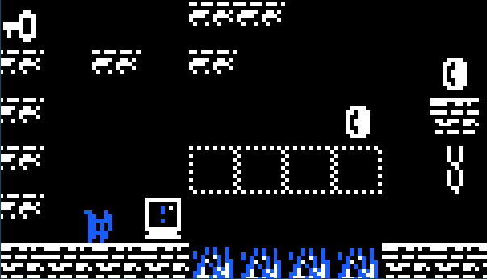

# Dunjo

2D platformer game prototype built using SFML.


---
## Prerequisites
- A **C++ compiler** supporting C++17 or later.
- **CMake** (version 3.10 or higher).
- **SFML** (version 3.0).  
---
## Build Instructions
```
git clone https://github.com/ricardo-alberti/Dunjo
cd Dunjo
mkdir out
cd out
cmake ..
make
./Dunjo
```
## Useful references:
- Tileset by Arks: https://arks.itch.io/dungeon-platform-tileset/
- SFML: https://www.sfml-dev.org/
